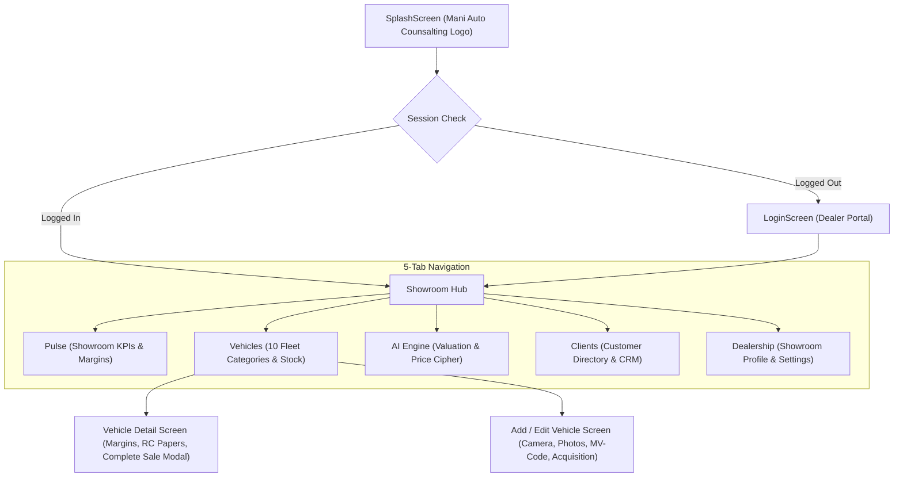

# Mani Auto Counsalting (Buy & Sell) - Mobile Dealership App

Executive mobile vehicle inventory and dealership management system built with **React Native CLI** and **MySQL**.

---

## Key Specifications

- **Dealership:** Mani Auto Counsalting (Buy & Sell)
- **Proprietor:** Prop. M.V. Deena
- **Location:** 269 Nadu Paiyur, Paiyur Post, Krishnagiri Main Road • Pin 635112
- **Hotlines:** +91 7868882003 • +91 6383784040 • +91 9486070567
- **Motto:** *"Your Dream Vehicle, Our Priority" • Safe & Transparent Dealings*
- **App Name:** `MVDS App`
- **Application ID / Package Name:** `com.mvdsapp`
- **Frontend Stack:** React Native CLI 0.88, TypeScript, Safe Area Context, Vector Graphics & High-DPI Assets
- **Backend Stack:** Node.js, Express, `mysql2`, JWT, `bcryptjs`
- **Database:** MySQL (`mvds_db`)
- **Fleet Scope:** All Types of Vehicles A to Z (10 Categories):
  - Cars
  - Two Wheelers
  - JCB / Earth Movers
  - Tractors
  - Pickup
  - Tippers
  - Trucks
  - Buses
  - Vans
  - Special Vehicles

---

## Dealer Portal Credentials

| Credential | Value | Detail |
| :--- | :--- | :--- |
| **Phone Number** | `1234567890` | Showroom dealer phone |
| **Password** | `reset123` | Secured password |
| **Quick Action** | Tap **"Auto-Fill"** on Login Screen | Instantly populates credentials |

---

## Core System Architecture



---

## Database Architecture (`mvds_db`)

1. **`users` Table:**
   - `id`: INT AUTO_INCREMENT PRIMARY KEY
   - `name`: VARCHAR(100) (e.g. `Prop. M.V. Deena`)
   - `phone`: VARCHAR(20) UNIQUE (`1234567890`)
   - `password`: VARCHAR(255) (Bcrypt hash)
   - `role`: ENUM (`OWNER`, `MANAGER`, `STAFF`)

2. **`customers` Table:**
   - `id`: INT AUTO_INCREMENT PRIMARY KEY
   - `name`: VARCHAR(100)
   - `phone`: VARCHAR(20)
   - `email`: VARCHAR(100)
   - `address`: TEXT
   - `created_at`: TIMESTAMP

3. **`vehicles` Table:**
   - `id`: INT AUTO_INCREMENT PRIMARY KEY
   - `vehicle_name`: VARCHAR(150)
   - `brand`: VARCHAR(100)
   - `model_year`: INT
   - `registration_number`: VARCHAR(50) (e.g. `TN 24 J 9204`)
   - `vehicle_type`: VARCHAR(50) (10 Categories A to Z)
   - `bought_price`: DECIMAL(12,2) (Confidential acquisition cost)
   - `price_code`: VARCHAR(50) (Secret dealer quote code, e.g. `MV-1.56Cr`)
   - `selling_price`: DECIMAL(12,2) (Target or negotiated selling quote)
   - `date_bought`: DATETIME (Timestamp when acquired)
   - `date_sold`: DATETIME NULL (Timestamp when sold)
   - `status`: ENUM (`AVAILABLE`, `BOOKED`, `SOLD`)
   - `customer_id`: INT NULL (Foreign key to `customers`)
   - `image_base64`: LONGTEXT (Base64 JPEG representation)
   - `notes`: TEXT (Condition, RC status, verification notes)

---

## How to Run the App

### 1. Database Setup & Backend Server
Ensure MySQL is running on port `3306`:
```bash
cd backend
cp .env.example .env
# Update MySQL password if required
npm install
npm run setup
npm start
```
The backend starts on `http://0.0.0.0:5001`.
- Health Check: `http://localhost:5001/api/health`

### 2. Run the React Native Mobile App
```bash
cd MVDSApp
npm install

# Run on Android Emulator or Connected Device:
npm run android

# Start Metro Bundler:
npm start
```

---

## Design System
- **Colors:** Deep Slate (`#0F172A`), Showroom Blue (`#2563EB`, `#1D4ED8`), Emerald Available (`#059669`), Sold Indigo (`#4F46E5`), Surface White (`#FFFFFF`).
- **Typography:** System fonts with tabular figures for currency, registration plates, and MV-Cipher codes.
- **Micro-Interactions:** Keyboard-avoiding bottom sheets, smooth entrance transitions, and zero AI clutter.
